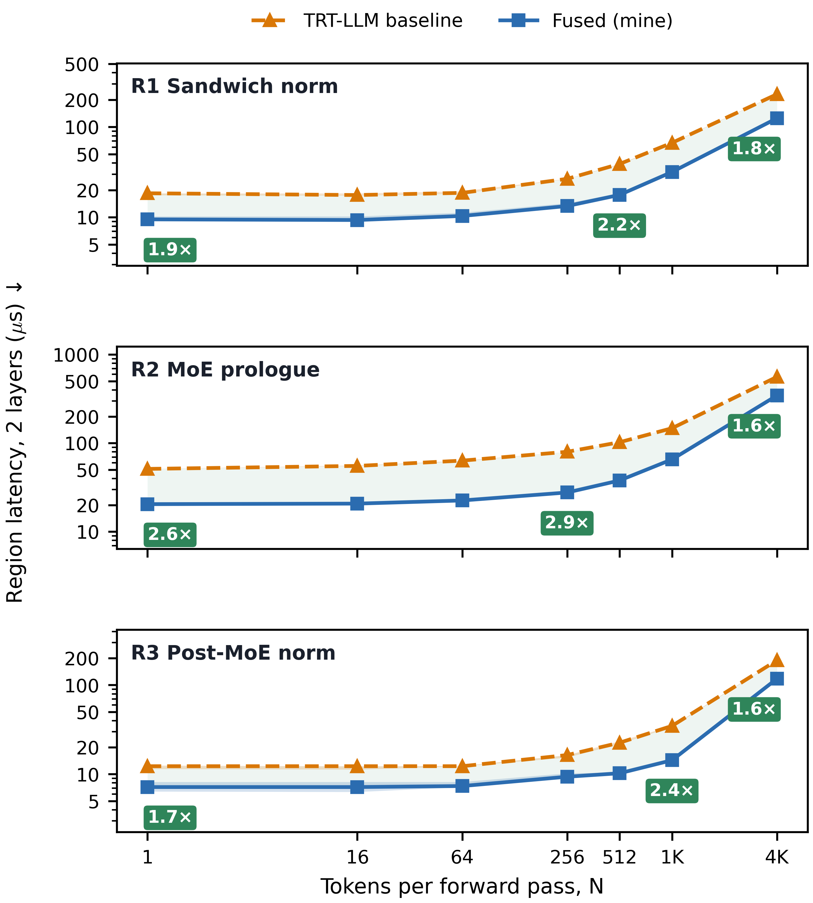
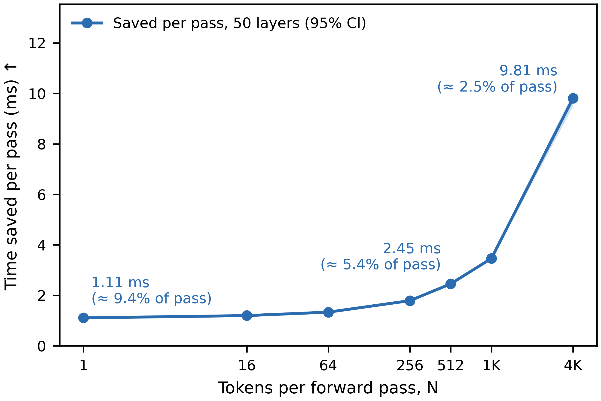

# Kolibri-Fusions: Production In-Register CUDA Kernels for 78B MoE Inference

[-76B900.svg)](https://www.nvidia.com)

[-blue.svg)](assets/Kolibri%20Optimization%20--%20Presentation.pdf)

Production CUDA kernel fusions for the **Kolibri 1 (78B MoE)** decoder stack in **NVIDIA TensorRT-LLM**, eliminating non-GEMM memory bandwidth bottlenecks and launch bubbles across 50 decoder layers.

> **Presentation Slide Deck**: A high-level overview of the architectural challenges, kernel fusions, and empirical results is available in [`Kolibri Optimization -- Presentation.pdf`](assets/Kolibri%20Optimization%20--%20Presentation.pdf).

---

## 1. Executive Summary

While large matrix multiplications (GEMMs) dominate total FLOPs during large-batch prefill, **decode latency in sparse Mixture-of-Experts (MoE) architectures is bottlenecked by non-GEMM memory bandwidth and kernel launch latency**. In Kolibri 1 (50 layers, $E = 384$ experts, $\text{Top-}K = 6$, $D = 2560$), standard TensorRT-LLM dispatches up to 7 separate memory-bound kernels per layer for normalization, residual accumulation, router top-$K$ selection, dispatch mapping, and token expansion.

This repository provides **three self-contained, production CUDA fusions** that replace these 7 disjoint operations with 3 highly tuned, in-register kernels:

1. **Region 1: Sandwich Norm (`fusions/01_sandwich_norm`)**: Fused Post-Attention RMSNorm + Residual Add + Pre-MoE RMSNorm (**1.85× – 2.18×** speedup).
2. **Region 2: MoE Prologue (`fusions/03_moe_prologue`)**: Fused Router Top-6 + Dispatch Mapping + Vectorized Row Expansion (**1.63× – 2.90×** speedup).
3. **Region 3: Post-MoE Norm (`fusions/02_post_moe_norm`)**: Fused Routed + Shared Expert Add + Post-FFN RMSNorm (**1.60× – 2.40×** speedup).

Across the entire 50-layer decoder stack, these optimizations save **1.11 ms to 9.82 ms per forward pass**, accelerating non-GEMM decode by over **2.2×**.

---

## 2. Kolibri Architecture & Optimization Regions

---

## 3. Empirical Results

All benchmarks were evaluated on an **NVIDIA GeForce RTX 4090** (Ada Lovelace, 128 SMs, 24 GB GDDR6X, sm_89) under **TensorRT-LLM 1.3.0** with locked clocks and real 2-block production weights (`checkpoints/kolibri_2blocks_real.pt`).

### Level 1: Fusion Regions Breakdown (Microbenchmarks)
*Latency measured in microseconds ($\mu\text{s}$), paired execution across 200 runs with interleaved clock-drift cancellation:*

| Tokens ($N$) | R1 Baseline | R1 Fused | R1 Speedup | R2 Baseline | R2 Fused | R2 Speedup | R3 Baseline | R3 Fused | R3 Speedup | **Total Fusion Speedup** |
|:---:|:---:|:---:|:---:|:---:|:---:|:---:|:---:|:---:|:---:|:---:|
| **1** (Decode) | 18.15 $\mu$s | 9.63 $\mu$s | **1.89×** | 51.29 $\mu$s | 20.16 $\mu$s | **2.54×** | 12.13 $\mu$s | 7.22 $\mu$s | **1.68×** | **2.20×** |
| **16** | 17.80 $\mu$s | 9.44 $\mu$s | **1.88×** | 55.68 $\mu$s | 20.95 $\mu$s | **2.66×** | 11.98 $\mu$s | 7.21 $\mu$s | **1.66×** | **2.27×** |
| **64** | 18.82 $\mu$s | 10.70 $\mu$s | **1.76×** | 63.08 $\mu$s | 22.37 $\mu$s | **2.82×** | 12.34 $\mu$s | 7.47 $\mu$s | **1.65×** | **2.33×** |
| **256** | 26.58 $\mu$s | 13.48 $\mu$s | **1.97×** | 79.77 $\mu$s | 27.88 $\mu$s | **2.86×** | 16.08 $\mu$s | 9.55 $\mu$s | **1.68×** | **2.40×** |
| **512** (Prefill) | 38.78 $\mu$s | 17.83 $\mu$s | **2.18×** | 102.73 $\mu$s | 37.70 $\mu$s | **2.72×** | 22.56 $\mu$s | 10.48 $\mu$s | **2.15×** | **2.49×** |
| **1024** | 67.15 $\mu$s | 31.36 $\mu$s | **2.14×** | 147.79 $\mu$s | 65.18 $\mu$s | **2.27×** | 34.68 $\mu$s | 14.47 $\mu$s | **2.40×** | **2.25×** |
| **4096** | 230.30 $\mu$s | 124.78 $\mu$s | **1.85×** | 560.50 $\mu$s | 344.88 $\mu$s | **1.63×** | 189.08 $\mu$s | 117.52 $\mu$s | **1.61×** | **1.67×** |

---

### Level 2: End-to-End 2-Block Forward Pass
*Measured with real CUTLASS Grouped MoE GEMMs, shared expert FFNs, and FlashAttention-2:*

| Tokens ($N$) | Baseline 2-Block ($\mu\text{s}$) | Fused 2-Block ($\mu\text{s}$) | $\Delta t_{\text{2-block}}$ Saved | E2E Speedup | Fusion Region Speedup |
|:---:|:---:|:---:|:---:|:---:|:---:|
| **1** | 470.1 $\pm$ 11.1 | 425.1 $\pm$ 2.3 | **+44.6 $\mu\text{s}$** | **1.106×** | **2.20×** |
| **16** | 628.0 $\pm$ 4.9 | 579.8 $\pm$ 1.2 | **+47.9 $\mu\text{s}$** | **1.083×** | **2.27×** |
| **64** | 803.4 $\pm$ 4.7 | 750.6 $\pm$ 3.3 | **+53.7 $\mu\text{s}$** | **1.070×** | **2.33×** |
| **256** | 1141.4 $\pm$ 4.4 | 1072.6 $\pm$ 1.7 | **+71.5 $\mu\text{s}$** | **1.064×** | **2.40×** |
| **512** | 1802.8 $\pm$ 5.1 | 1673.8 $\pm$ 2.9 | **+98.1 $\mu\text{s}$** | **1.077×** | **2.49×** |
| **1024** | 3483.2 $\pm$ 7.5 | 3341.6 $\pm$ 5.8 | **+138.6 $\mu\text{s}$** | **1.042×** | **2.25×** |
| **4096** | 15381.1 $\pm$ 112.9 | 15001.1 $\pm$ 100.4 | **+392.7 $\mu\text{s}$** | **1.025×** | **1.67×** |

---

### Level 3: 50-Layer Full Model Projection

Because Kolibri's 50 decoder layers share identical dimensions ($D=2560, E=384, K=6$) and execute sequentially, the measured latency reduction scales linearly across depth:
$$\Delta t_{\text{50-layer}} = 50 \times \left( \frac{\Delta t_{\text{2-block}}}{2} \right) = 25 \times \Delta t_{\text{2-block}}$$

* **Single-Token Decode ($N = 1$)**: Saves **1.115 ms per token** forward pass.
* **Mid-Batch ($N = 512$)**: Saves **2.453 ms per forward pass**.
* **Long Prefill ($N = 4096$)**: Saves **9.818 ms per forward pass**.

---

## 4. Integration into TensorRT-LLM

In addition to the self-contained fusions in this repository, all optimized kernels are integrated directly into [TensorRT-LLM](https://github.com/Amineki6/TensorRT-LLM) on branch `perf/kolibri-optimizations`:

### 1. C++ & CUDA Core Subsystem
* **Kernels Directory** (`cpp/tensorrt_llm/kernels/moe/`):
  * `sandwich_norm/`: Implements `kolibriSandwichNormKernel.cu` & `.h` for in-register residual and norm fusion.
  * `routing/`: Implements `kolibriRoutingKernels.cu` & `.h` for Bitonic padded Top-6 routing, dynamic dispatch mapping, and 128-bit row expansion.
  * `post_norm/`: Implements `kolibriPostMoeNormKernel.cu` & `.h` for fused routed + shared expert accumulation with RMSNorm.
* **PyTorch C++ Extensions (THOP)** (`cpp/tensorrt_llm/thop/moe/`):
  * Registered as native `torch.ops.trtllm.*` operators (`kolibri_sandwich_norm_op`, `kolibri_router_op`, `kolibri_post_moe_norm_op`, `kolibri_build_expert_maps_op`, `kolibri_activation_expansion_op`).
  * Seamlessly discovered via CMake's `file(GLOB_RECURSE ...)` targets into `th_common`.

### 2. PyTorch Model Integration (`tensorrt_llm/_torch/models/modeling_kolibri.py`)
* **Sandwich Norm**: `Kolibri1DecoderLayer.forward` invokes `torch.ops.trtllm.kolibri_sandwich_norm_op` directly in the forward graph.
* **Router**: `Kolibri1RoutingMethod.apply` dispatches to `torch.ops.trtllm.kolibri_router_op`, bypassing disjoint PyTorch sorting and indexing passes.
* **Post-MoE Norm**: `Kolibri1MoE.forward` incorporates a single-GPU ($TP = 1$) fast-path calling `torch.ops.trtllm.kolibri_post_moe_norm_op`, while preserving standard AllReduce accumulation for multi-GPU Tensor Parallelism.
* **CUDA Graph & torch.compile Compatibility**: All operations register abstract fake tensor implementations in `tensorrt_llm/_torch/custom_ops/cpp_custom_ops.py`.